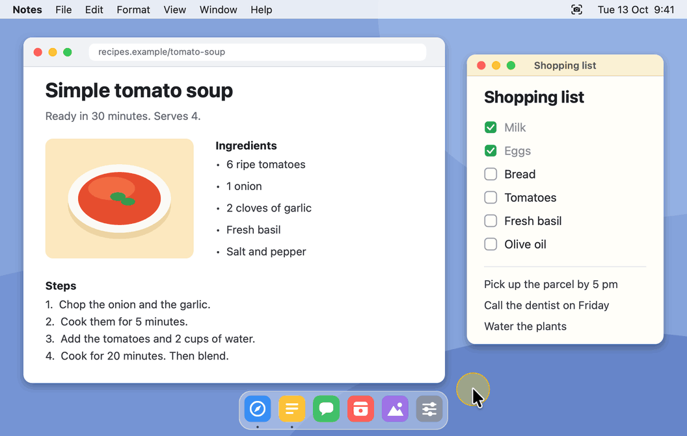
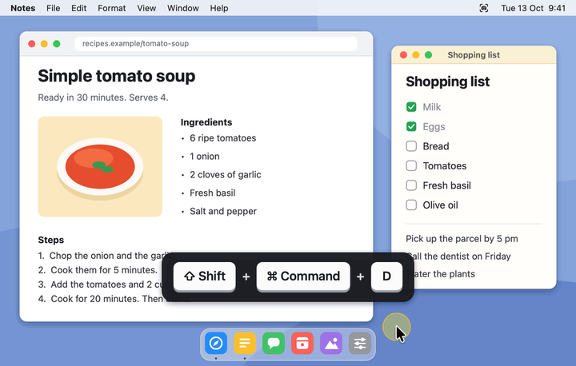
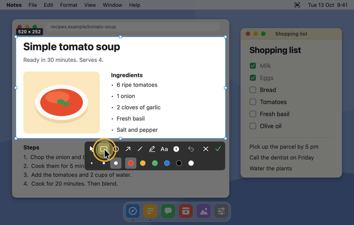
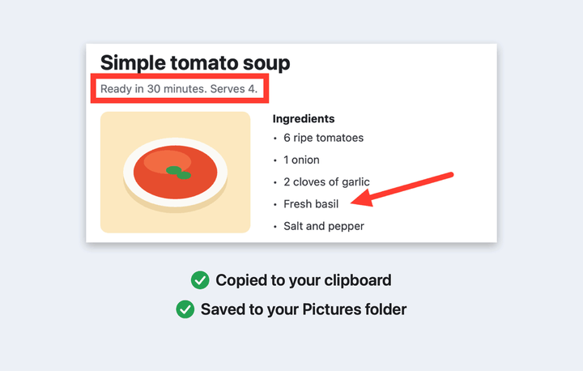
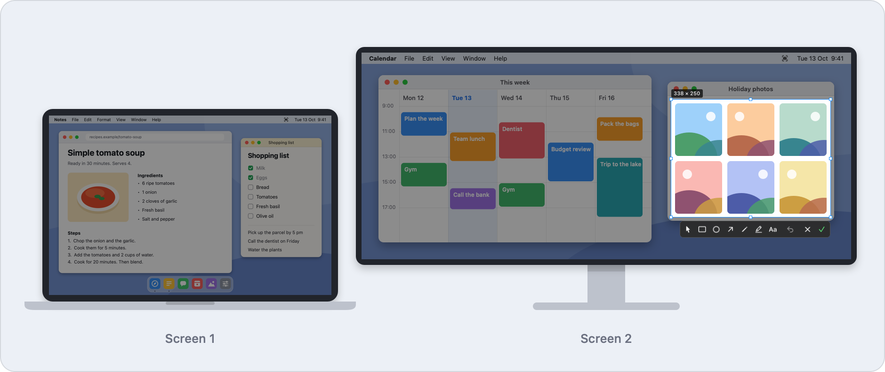
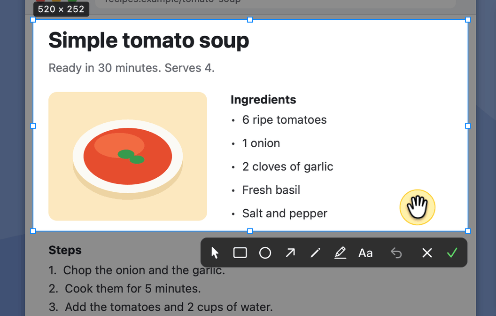
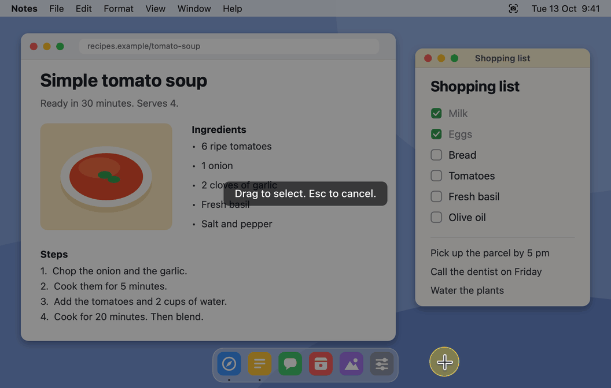
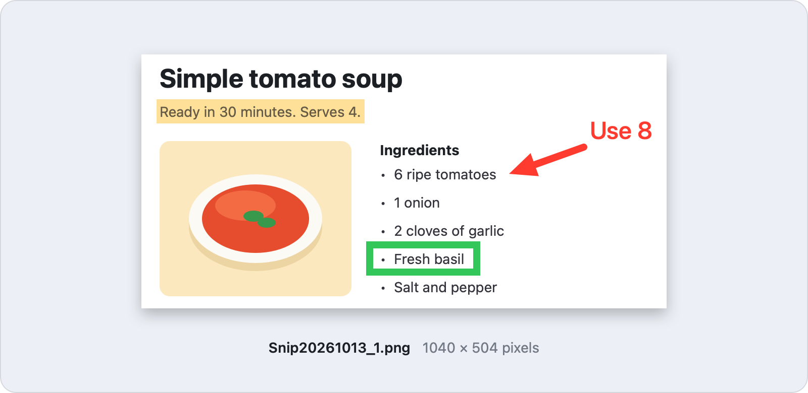
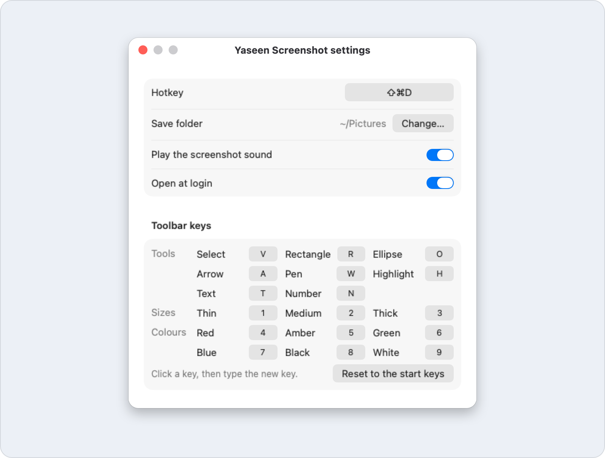

  

  
  
  

  <a href="https://github.com/yaseenarshad/yaseen-screenshot-app/releases/latest"><b>Download</b></a> ·
  <a href="#the-answer">How it works</a> ·
  <a href="#the-doubts">Questions</a> ·
  <a href="docs/GUIDE.md">Guide</a>

  <b>Your screenshot is on your clipboard and in your folder, on every monitor you plug in.</b>

  

  <a href="https://github.com/yaseenarshad/yaseen-screenshot-app/releases/latest"><b>Download for Mac</b></a> 
  Free · Apple Silicon · macOS 14 or later · under 1 MB

## The problem

I used the same screenshot app for years. Then I plugged in a second monitor, and it stopped working. I looked for a replacement, and each one had the same small problems:

- You start to select, and the screen changes. The thing that you wanted is gone.
- You take the shot. Then you open a second app to draw one arrow.
- You must choose: a file, or the clipboard. You wanted the two.
- You plug in a second monitor, and your screenshot tool stops working.

## The answer

Yaseen Screenshot freezes each screen, lets you mark the image at once, and then copies and saves it.

<table>
  <tr>
    <td align="center" width="33%"> <b>1. Press the hotkey</b> All screens freeze.</td>
    <td align="center" width="33%"> <b>2. Drag a box</b> Draw on it, if you want.</td>
    <td align="center" width="33%"> <b>3. Click Done</b> Copied and saved.</td>
  </tr>
</table>

## What it does

### Freeze every screen at once

Press the hotkey, and all your screens stop. A laptop screen and a wide monitor freeze together, each one at its own sharpness.

**So what:** you select what you saw, not what the screen became a second later. And a second monitor is not a problem. That is the reason this app exists.

  

### Mark it up, then fix it

Draw a rectangle, an ellipse, an arrow, a free line, a highlight, a note or numbered circles (1, 2, 3). Three sizes and six colours. One key picks each one: drag the box, press **R**, and drag a rectangle. Then click **Select** to move a mark, change its size, change its colour, or delete it.

**So what:** a mark in the wrong place is not a reason to start again.

  

### Grab a full window with one click

Move the pointer over a window, and it becomes bright. Click, and the box is exactly that window.

**So what:** you do not drag along the edges and miss by two pixels.

  

### Paste it now, find it later

Click **Done**, press **Enter**, press the hotkey again, or double-click in the box. The image goes to your clipboard and into your Pictures folder, each time, as a sharp PNG.

**So what:** you paste it into your message immediately, and the file is still there next week.

  

### Make it yours

Change the hotkey. Change the save folder. Turn the screenshot sound on or off. Let the app open when you log in. Change the toolbar keys. That is the full list of settings.

**So what:** it fits your keys and your folders, and there is nothing else to learn.

  

## The proof

Each number is measured, not estimated.

| What | Number |
| -- | -- |
| The app | 880 KB |
| The download | 333 KB |
| From the hotkey to the frozen screen | 109 ms on average (67 to 183 ms, 20 real captures on an M1 Max) |
| Automatic tests | 89 |

What the app does not need:

- No account.
- No payment.
- No internet. The app has no network code, so your screen stays on your Mac.
- No outside code. It is a native Mac app, written in Swift.

## The doubts

**Is it safe?**
The app reads the screen only when you press the hotkey. It has no network code. The code is in this repo, and you can read it.

**Does it work with two screens?**
Yes. That is the reason for the app. Each screen freezes, at its own sharpness.

**Does it cost money?**
No. It is free, with the [MIT license](LICENSE).

**Why does macOS warn me at the first start?**
Apple has not notarized the app. That needs a paid Apple developer account. You click "Open Anyway" one time.

**Does it run on an Intel Mac or on Windows?**
No. It is for Macs with Apple Silicon only.

## The download

[**Download the newest `.dmg`**](https://github.com/yaseenarshad/yaseen-screenshot-app/releases/latest). The app needs a Mac with Apple Silicon and macOS 14 or later.

1. Open the `.dmg`. Drag **Yaseen Screenshot** to **Applications**.
2. Open the app. Go to **System Settings › Privacy & Security** and click **Open Anyway**.
3. Turn on the **Screen Recording** permission when the app asks.

The first three things to try:

1. Press **Shift-Command-D** and drag a box. Press **Enter**. Then paste.
2. Press the hotkey again and click a window. The box goes around it.
3. Draw an arrow. Then click **Select** and move the arrow.

## For developers

The app is one Swift package with no outside package. The [developer page](docs/DEVELOPMENT.md) tells how to build, test, sign and release it. The [guide](docs/GUIDE.md) has each detail for users.

The license is [MIT](LICENSE).
